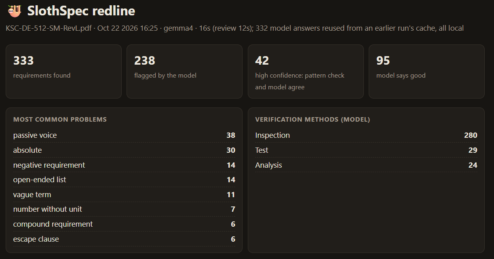

# 🦥 SlothSpec

Drop a requirements spec in a folder. Go get coffee. Come back to a redline.

SlothSpec reads a spec (.docx, .pdf, .txt, .md), pulls out every "shall" statement, and flags the stuff a reviewer would circle in red: vague words, TBDs, escape clauses, compound requirements, numbers with no units. Then local open-weight models (Gemma 4 via Ollama) grade each one, say how you'd verify it, and suggest a rewrite.

Nothing leaves your machine. No API key, no cloud, no per-token bill.

**Live sample report:** https://senseinate.github.io/slothspec/ · **Real NASA spec report:** https://senseinate.github.io/slothspec/nasa.html



Write-up: [docs/post.md](docs/post.md) (the DEV Hacktoberfest 2026 Week 3 submission).

## Why local

A lot of specs can't be pasted into a hosted chatbot. Proprietary, export controlled, or just "please don't." Running the model on your own box means the tool is actually allowed to touch the documents it was built for.

## Quick start

```bash
# 1. get Ollama + Gemma 4
ollama pull gemma4

# 2. install
pip install -e .

# 3. one file
slothspec review examples/sample_spec.txt

# or the lazy way: leave it watching a folder
slothspec watch ~/Specs/inbox
```

On Windows, if `slothspec` isn't found after install, use `python -m slothspec` instead.

Reports land as `<name>.redline.html` (open in a browser) and `<name>.redline.csv` (paste into a comment matrix or RVTM).

## Modes

| mode | command | what happens |
|---|---|---|
| **single** (default, recommended) | `--model gemma4` | One model grades and rewrites every requirement. |
| hybrid (experimental) | `--grader gemma4:e2b --editor gemma4` | Small model grades everything; big model rewrites only what got flagged. |
| rules only | `--rules-only` | Pattern checks only. No model, instant. |

## Results

Sample spec: 20 requirements (15 with planted problems, 5 clean). 16 GB laptop, integrated graphics, CPU only. Full history in [CHANGELOG.md](CHANGELOG.md).

| latest run of each | single, gemma4 (e4b) | single, gemma4:e2b (v0.2.0) | hybrid |
|---|---|---|---|
| Planted problems caught (of 15) | 15 | 15 | 15 |
| Clean requirements left alone (of 5) | 3 | **5** | **5** |
| Rewrites that actually fixed it (of 15) | **11 to 14** | 8 | 11 |
| Time | **3.4 min** | 3.5 min | 4.9 min |

What held up across every run:
- Every model caught every planted problem, every version.
- e2b is the better grader: it never flagged a clean requirement. e4b flags 2 of 5 that are fine.
- e4b writes better rewrites. Every run.
- Hybrid (e2b grades, e4b rewrites) looked like the best of both on paper. It never beat e4b alone: slower every time, rewrites no better. It's kept as an option if false alarms bother you more than rewrite quality.

Known limitation: "food-safe materials and/or BPA-free plastic" came back as two mandatory requirements (AND) in every run, every model. If your spec uses and/or, read those rewrites carefully.

On a 20-requirement spec, differences of 2 or 3 are within run-to-run noise. The e4b range is across two runs with a one-line prompt change between them.

### Real-world test: NASA KSC-DE-512-SM

A 97-page NASA Kennedy ground support equipment design standard, approved for public release ([details](examples/nasa-ksc/RESULTS.md)). `--verbs shall`, gemma4, same laptop.

| | |
|---|---|
| Shall requirements extracted | 333, each with its real section ID (`5.4.7a`, `6.3.1.1b(2)(a)`) |
| Time | about 56 to 58 min, unattended |
| Flagged | 238 (71%), down from 94% before the standard-reference fix |
| High-confidence (pattern checks and model agree) | 42, near the top of the report (it sorts pattern hits first) |

Real catches include "mitigated to an acceptable level" (acceptable to whom?), filters "as close as possible" to flight hardware, "certified as required", and redundant systems "physically oriented or separated" with no separation criteria. The model is still pickier than a human reviewer; trust the top of the report and skim the rest.

## Options

| flag | what it does |
|---|---|
| `--grader MODEL` / `--editor MODEL` | hybrid mode. If you give only one, the other uses `--model`. |
| `--model MODEL` | single mode model (default `gemma4`). Any Ollama tag works. |
| `--rules-only` | skip the model |
| `--verbs shall` | which verbs count as requirements (default `shall,must,will,should`). Use `shall` when the spec defines "should" as guidance. |
| `--out DIR` | where to write the report (review) |
| `--interval N` | seconds between folder checks (watch) |

Env vars: `OLLAMA_HOST` (default `http://localhost:11434`), `SLOTHSPEC_MODEL`.

## Tests

```bash
python tests/test_regression.py     # or: python -m pytest tests
```

No model or network needed. Locks in the sample spec output and the pattern rules, so a change that breaks extraction shows up immediately.

## How it works

1. **Extract.** Pulls every sentence with a binding verb. IDs come from the line (`SYS-042`) or the document's own outline (`5.4.7a`). Strips PDF headers, footers, tables of contents, rationale notes, and the government forms stapled to the back.
2. **Pattern checks.** Deterministic regex rules. Fast, free, same flags every time.
3. **Model pass.** Each requirement plus its pattern hits goes to the local model with a fixed JSON schema, so output is always structured. Temperature 0, thinking off. The model is told never to invent numbers; missing thresholds come back as `<<placeholders>>`.
4. **Cache.** Answers are keyed by model + prompt + text, so re-running after you fix 3 requirements only re-checks those 3.

See [CHANGELOG.md](CHANGELOG.md) for what changed between versions and the results behind each change.

## License

MIT
